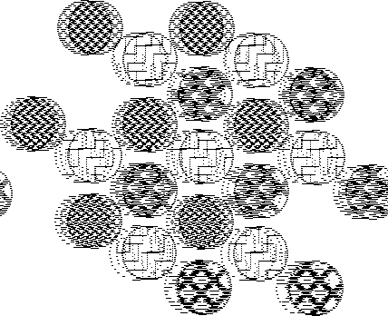
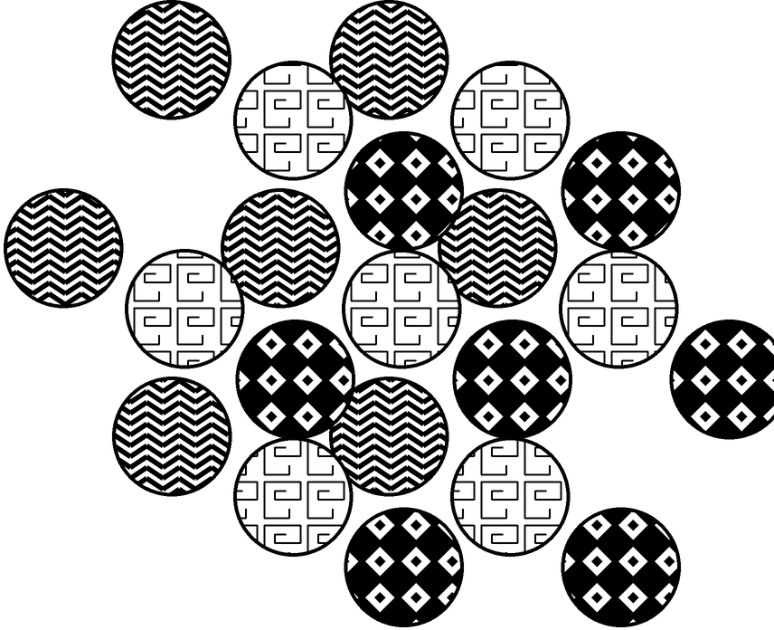
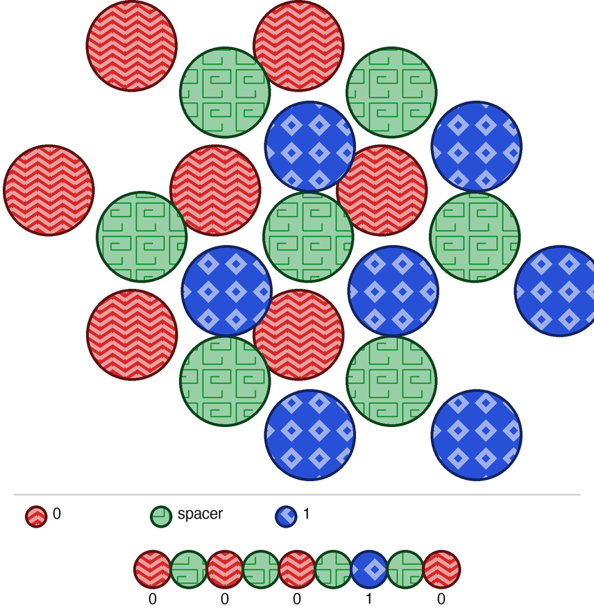

# Atomic Layer Memory

**[← All projects](https://gernreich.github.io/)**

An idea for storing data at the atomic level, which the author thought up after
reading K. Eric Drexler's *Nanosystems*. Atoms of one element, all silicon or
all carbon, are stacked in close-packed layers, and every layer sits on one of three
sites, A, B or C.
The two outer sites carry the bits and the middle one is a spacer laid between
every bit:

| site | meaning | colour |
|------|---------|--------|
| A    | 0       | red    |
| B    | spacer  | green  |
| C    | 1       | blue   |

So 0 spacer 0 spacer 0 spacer 1 spacer 0 is the stack A B A B A B C B A.

**[Turn it in 3D](https://gernreich.github.io/atomic-layer-memory/)**: type any
bit string to see its stack, look down on it or from the side, and watch an atomic
force microscope tip read it back.

## Why the spacer works

A close-packed layer has to nest in the hollows of the layer below, so two
neighbouring layers can never sit on the same site. With B between every bit,
every neighbouring pair is A–B or C–B, so any bit string is a stack that can
physically exist: 00 becomes A B A, never A A.

## Silicon or carbon

Each stack is one element, silicon or carbon, never both. Both crystallise as
diamond, in layers that sit on A, B or C sites. Left alone they repeat A B C, but
a layer on another site, a stacking fault, is a known defect in both, and both
have hexagonal forms stacked A B A B. Here every bit is a deliberate choice of
site. The page uses each element's own spacing, from its lattice constant a
(atoms in a layer a/√2 apart, layers a/√3):

| element | a        | in a layer | per layer | per bit with spacer |
|---------|----------|------------|-----------|---------------------|
| silicon | 0.543 nm | 0.384 nm   | 0.314 nm  | 0.627 nm            |
| carbon  | 0.357 nm | 0.252 nm   | 0.206 nm  | 0.412 nm            |

Each ball on the page stands for a pair of atoms, since both crystals hold two at
every site, so a bit costs four atoms for every ball in a layer: 28 with the
seven of the drawing. Other ways of putting the density:

| element | bits per µm | exabytes per cm³, 7 / 19 / 37 balls per layer |
|---------|-------------|-----------------------------------------------|
| silicon | 1,595       | 223 / 82 / 42                                 |
| carbon  | 2,428       | 787 / 290 / 149                               |

The volume figure assumes stacks of that size packed side by side through the
crystal.

## For scale, against DNA

Each base pair of DNA stores 2 bits, and base pairs sit 0.34 nm apart, so DNA takes
about 0.17 nm per bit. That is denser along its length than the carbon stack at
0.41 nm. But DNA is read by sequencing it, not by running a tip along it, and the
stack is a solid crystal.

## Reading it from the side

Seen from the cut side face, the three sites lie at three different positions
across the face: A at 0, B a third of the way along the row pitch and C two thirds.
An atomic force microscope tip run up the stack meets each layer's row of atoms at
one of those places, and the zig-zag it traces is the code.

## The 2009 drawing

<table>
<tr>
<td align="center"></td>
<td align="center"></td>
<td align="center"></td>
</tr>
<tr><td align="center">2009</td><td align="center">redrawn</td><td align="center">in colour</td></tr>
</table>

`images/atomic_i_2009.png` is the author's original drawing: three hexagonal groups
of seven circles, offset from one another, in 1-bit black and white. It was a
428 × 348 GIF from 2009 and is kept here as a PNG with the same pixels. Its lines
had broken up into short dashes. `images/atomic_i_redrawn.png` redraws it cleanly on the
same centres, and `images/atomic_i_rgb.png` colours the groups and adds a key with
the example sequence. The textures inside the circles are new; only the layout and
which texture belongs to which group come from the original.

## Files

- `index.html` — the 3D page (three.js, loaded from a CDN)
- `images/` — the 2009 drawing and the two redraws
- `tools/find_centres.py` — finds all 21 circle centres in the drawing, writes `tools/centres.json`
- `tools/redraw.py`, `tools/redraw_rgb.py` — draw the two PNGs from those centres

The tools need Python 3 with Pillow and numpy:

    python3 tools/find_centres.py images/atomic_i_2009.png
    python3 tools/redraw.py images/atomic_i_redrawn.png
    python3 tools/redraw_rgb.py images/atomic_i_rgb.png

## License

CC0 1.0 Universal; see `LICENSE`.
